# تقرير التدقيق الشامل الحيّ (المطابقة المحاسبية + التحقق البصري الفعلي) — `ERP_Cloud`

- **تاريخ التنفيذ الفعلي:** `2026-10-25`
- **الفرع / اللقطة المفحوصة:** `arena/4c98c7f3-erp-cloud` (مفرّع من `c71485e9fb5f91afcefcb26f738c3c2c01ed79ce`)
- **منهجية الفحص:** تشغيل حيّ كامل لقاعدة البيانات والخادم والتطبيقات الثلاثة المبنية للإنتاج، متبوعاً بـ:
  1. **التنفيذ المحاسبي والمطابقة الآلية الشاملة** عبر `pnpm verify-seed` على المستأجر المعياري `verify2026` + مسح شامل لـ **`108` تقارير** في كتالوج التقارير + فاحصات إعادة إنتاج حية (`P1..P8`) على مستأجر معزول.
  2. **التحقق البصري الحقيقي بالمتصفح (`Headless Chromium` — `1440×960 RTL ar-SA`)** مع فتح الشاشات فعلياً، التقاط **`38` لقطة شاشة كاملة**، فحصها بصرياً بالعين، ومطابقة كل رقم معروض على الواجهة مع أرصدة دفتر الأستاذ العام (`GL`) والدفاتر الفرعية (`Subledgers`).
- **مجلد الأدلة المرفق:** [`docs/accounting-audit/evidence/live-audit-2026-10-25/`](./evidence/live-audit-2026-10-25/) (يتضمن `live-audit-summary.json` + `19` لقطة شاشة مرجعية موثّقة).

---

## 1. ملخص تنفيذي صريح

### 1.1 ما يعمل بمتانة عالية (مُثبَت بالتشغيل الحيّ لا بالقراءة النظرية فقط)

| المحور المفحوص حيّاً | النتيجة الفعلية | الدليل المباشر |
|---|---|---|
| **قاعدة البيانات والترحيلات (`PostgreSQL 16.14`)** | تطبيق **`152 / 152` ترحيلة** بنجاح (`0` أخطاء) وبذر المنصة والمستأجر التجريبي | `pnpm db:migrate` + `pnpm db:seed` على `127.0.0.1:5432` |
| **بناءات الإنتاج الكاملة (`Production Builds`)** | نجاح بناء جميع الحزم والخادم والواجهات الثلاث: `@erp/staff` (**`188` مساراً**)، `@erp/customer-portal` (**`12` مساراً**)، `@erp/bakery` (**`14` مساراً**) | `NODE_ENV=production pnpm --filter ... build` وتشغيلها على `:3000`, `:3001`, `:3004`, `:3005` |
| **بذرة التحقق الشاملة (`pnpm verify-seed`)** | **`8 / 8 PASS`** — توازن ميزان المراجعة (`252,066.20 = 252,066.20`)، وتطابق الصندوق والبنك والذمم المدينة والدائنة والمخزون والضريبة وقائمة الدخل | دورة كاملة من `13` قيداً مرحّلاً (`JE-000001..JE-000013`) على `verify2026` |
| **تقرير مطابقة الأستاذ مع الدفاتر الفرعية (`MF-33`)** | **`6 / 6` أزواج مطابقة بفارق `0.00`** على `verify2026`، ورصد فوري لفارق `+1.00` عند اختبار `ACC-061` | لقطتا `14-report-subledger-reconciliation.png` و`31-demo-recon-acc061-diff-1sar.png` |
| **مسح كتالوج التقارير الكامل (`Report Catalog`)** | **`108 / 108` تقارير أعادت `200 OK`** مع معاملات الفترة (`from/to`) و**`108 / 108` `200 OK`** بدون معاملات (**`0 × 5xx`، `0 × 4xx`**) | `live-audit-summary.json` → `reportCatalogSweep` |
| **التكامل عبر التطبيقات الثلاثة (`Staff` + `Portal` + `Bakery`)** | العميل الآجل يرى رصيده الدقيق **`139.20 ر.س.`** في بوابة العملاء (`:3004`)، والمندوب يرى رصيد سيارته الدقيق **`5.0000 كجم` (`50.0000 ريال`)** في تطبيق المخبز (`:3005/rep`) مع حجب `/reps` بـ `403` | لقطات `19-portal-invoices.png`، `20-portal-statement.png`، `21-bakery-rep.png`، `22-bakery-reps-rbac.png` |

### 1.2 أهم ما كشفه الجمع بين الفحص البصري والمطابقة الحية

1. **تعارض رقمي حيّ في بطاقة ذمم المبيعات على شاشة `/sales/invoices` (`NEW-01` — شدة عالية `HIGH`):**
   بينما يبلغ رصيد العملاء الحقيقي في الأستاذ (`12310001`) وتقرير أعمار الديون (`ar-aging`) وبوابة العملاء (`:3004`) ومطابقة `MF-33` مبلغ **`139.20 ر.س.`** بالضبط (`285.20` فاتورة آجلة − `100.00` تحصيل − `46.00` مردود مبيعات `SR-000001`)، تعرض شاشة الموظفين `/sales/invoices` في بطاقة **«غير مسددة — المتبقي على العملاء (ذمم المبيعات)»** مبلغ **`185.20`** (متجاهلةً مردود المبيعات `46.00` بالكامل!)، كما تضع شارة **`غير مسدّدة`** على مردود المبيعات المرحّل `SR-000001` نفسه!
2. **استمرار عيوب محاسبية وتشغيلية مفتوحة ومُثبَتة بإعادة الإنتاج الحية:**
   - **`ACC-222` (`OPEN` — `MEDIUM`):** كشف حساب الطرف (`GET /parties/:id/statement` وشاشة `/sales/statements`) يدمج كل سطور الطرف (بما فيها الذمم الدائنة وأي سطر مصروف موسوم بالطرف) في حقل `receivable`، ويثبّت `payable` دائماً على `'0.0000'` — فظهر رصيد المورد على الشاشة **`الرصيد المدين (مستحق لنا): -275.00`** و**`الرصيد الدائن: 0.00`**، وللطرف المزدوج (`both`) أرجع `-115.0000` بدل (`مدين 115.00` / `دائن 230.00`).
   - **`ACC-061` (`POLICY-DOCUMENTED` ذو أثر انحراف فعلي — `HIGH`):** خصم رأس فاتورة الشراء (`invoiceDiscount = 1.00`) يقيّد المخزون في الأستاذ بالإجمالي (`1270001 = 36.00` + `3200003 خصم مكتسب = 1.00`) بينما تدخل حركة المخزون بالصافي (`stock_balances = 35.00`)، ما أحدث **فارقاً دائماً قدره `1.00` بحالة `فرق`** داخل تقرير `MF-33` نفسه (`31-demo-recon-acc061-diff-1sar.png`)!
   - **`ACC-138` و`ACC-111` (`DEFERRED-TO-MF` — `HIGH / MEDIUM`):** محرك العروض الترويجية (`/sales/offers/:id/evaluate` يحسب خصم `8.0000` بنجاح) وقوائم الأسعار (`/price-lists`) **غير موصولين** بإنشاء/ترحيل فواتير المبيعات؛ الفاتورة المؤهلة تترحّل بإجمالي كامل **`92.00`** بدل **`82.80`** (`discount = 0.0000`).
   - **`ACC-139` / `MF-01` (مُصلَح جزئياً في التنبيه وبقي أصل الخلل — `MEDIUM/HIGH`):** ما يزال `POST/PATCH /accounts` يقبل رصيداً افتتاحياً أحادي الطرف (`1,500.00` بلا قيد ولا حساب مقابل)، فيختل ميزان المراجعة (`252,426.25` مدين مقابل `250,926.25` دائن — فرق **`1,500.00 مدين`**)، بينما تُدرج الميزانية العمومية (`balance-sheet`) سطراً اصطناعياً بلا رقم حساب تحت حقوق الملكية باسم `أرصدة افتتاحية = 1500.0000` لإجبار التوازن!
   - **`ACC-221` (`OPEN` — `LOW`):** `POST /api/v1/accounts` بنوع خارج الخماسي (`type: 'income'`) ينفجر بـ **`500 INTERNAL`** بدل `422`.
   - **`ACC-209` (مؤكد أثناء البناء الحيّ — `MEDIUM`):** بناء `@erp/staff` طبع صراحةً **`Skipping linting`** بسبب `eslint: { ignoreDuringBuilds: true }` في `apps/staff/next.config.mjs`.
3. **عيوب بصرية وتجربة مستخدم واضحة بالعين المجردة (`NEW-02` .. `NEW-07`):**
   - **`NEW-03`:** شاشة `/accounting/cost-centers` تعرض في كل صف **زراً أبيض فارغاً ممتداً بعرض نصف الشاشة** (`<Link>` بلا نص في السطر `356`)، وبجانبه **زر الحذف الأحمر مع أيقونة سلة المهملات مكتوباً عليه «`🗑 كشف الحساب`»** (`L364`)!
   - **`NEW-04`:** الشريط الجانبي الداكن في `apps/staff` يعرض **6 أزرار بيضاء بنص أبيض/باهت شبه غير مرئي** (`مبيعات`، `نقاط البيع`، `عملاء`، `موردين`، `مناديب`، `التقارير`) في جميع صفحات النظام.
   - **`NEW-02`:** شاشة `/sales/statements` تفتقر تماماً لعمودَي **رقم المستند والبيان**، وتكرّر قيمة `المسدّد` (`300.00`) على سطر سند الصرف نفسه، وتثبّت العنوان العلوي على `كشف مورد` حتى عند عرض كشف عميل!
   - **`NEW-05`:** أزرار `<Link>` مربعة فارغة بلا نص في `/accounting/ledger` (`L509`)، وتداخل الزر العائم `مساعد` مع زر `حفظ كمسودة` وأعمدة الجداول، وقصّ حقول مودال التفصيل في `/tailoring/invoices`.

---

## 2. جدول المطابقة الشامل لبذرة `verify2026` (الأستاذ ⇔ الفرعي ⇔ API ⇔ الشاشات الحية)

تم تنفيذ `VERIFY_PORTAL_URL=http://localhost:3004 pnpm verify-seed` مرتين على PostgreSQL 16 المحلي (`8/8 PASS`)، ثم فُتحت كل شاشة في المتصفح الفعلي للتحقق من تطابق الأرقام المعروضة للمستخدم مع الدفاتر:

| البند المحاسبي | رصيد الأستاذ العام (`GL`) | رصيد الدفتر الفرعي / التقرير (`API`) | الرقم المعروض فعلياً على الشاشة (`UI`) | حالة المطابقة والدليل البصري |
|---|---:|---:|---:|---|
| **ميزان المراجعة — حركة الفترة (`JE-000001..13`)** | مدين `252,066.20` = دائن `252,066.20` | `252,066.20` / فرق `0.00` | حركة مدين **`252,066.20`** · حركة دائن **`252,066.20`** · الرصيد **`0.00`** | ✅ **مطابق 100%** (`10-accounting-trial-balance.png`) |
| **ميزان المراجعة — الأرصدة الختامية** | مدين `250,723.00` = دائن `250,723.00` | `250,723.00` | ختامي مدين **`250,723.00`** · ختامي دائن **`250,723.00`** | ✅ **مطابق 100%** (`10-accounting-trial-balance.png`) |
| **الصندوق الرئيسي (`1211001`)** | `49,890.00` (`50,330` − `440`) | `cash_location_balances`: `49,890.00` | كشف حساب `1211001`: مدين **`50,330.00`**، دائن **`440.00`**، ختامي **`49,890.00`** (`7` حركات) | ✅ **مطابق 100%** (`12-accounting-ledger.png` + `14-report-subledger-reconciliation.png`) |
| **البنك الرئيسي / شبكة (`1221001`)** | `180,100.00` (`180,000` + `100`) | `cash_location_balances`: `180,100.00` | ميزان المراجعة + الميزانية + `MF-33`: **`180,100.00`** | ✅ **مطابق 100%** (`10-accounting-trial-balance.png` + `14-report-subledger-reconciliation.png`) |
| **الذمم المدينة (`12310001` — عميل التحقق الآجل)** | **`139.20`** (`285.20 − 46.00 − 100.00`) | `ar-aging`: **`139.20`** · `MF-33`: **`139.20`** | بوابة العملاء `:3004`: **`139.20 ر.س.`** · كشف عميل: **`139.20`** · **لكن `/sales/invoices` تعرض `غير مسددة: 185.20`!** | ⚠️ **تعارض واجهة في `/sales/invoices` (`NEW-01`)** مقابل تطابق الأستاذ وبوابة العملاء (`03-sales-invoices.png` مقابل `19-portal-invoices.png`) |
| **الذمم الدائنة (`22111001` — مورد التحقق)** | **`275.00`** دائن (`575.00 − 300.00`) | `ap-aging`: **`275.00`** · `MF-33`: **`275.00`** | `/purchases/invoices`: `مستحق للموردين 275.00` · **لكن `/sales/statements` للمورد تعرض `الرصيد المدين: -275.00` و`الدائن: 0.00`!** | ⚠️ **خلل `ACC-222` + `NEW-02` في `/sales/statements`** (`06-purchases-invoices.png` مقابل `05-sales-statements-supplier-acc222.png`) |
| **المخزون (`1270001` — جرد المواد + عهدة السيارة)** | **`350.00`** (`570.00 − 220.00`) | `stock_balances`: `220 + 50 + 80 = 350.00` (`43` وحدة) | `/inventory/levels`: القيمة **`350.00`**، الكمية **`43`** · تطبيق المندوب `:3005/rep`: **`5.0000 كجم` = `50.0000 ريال`** | ✅ **مطابق 100%** عبر `Staff` و`Bakery` (`07-inventory-levels.png` + `21-bakery-rep.png`) |
| **مراقبة البضاعة/النقد تحت التحويل (`1270003`, `1211003`)** | `0.00` لكليهما (`50−50`، `100−100`) | مناقلتان مكتملتا الإرسال والاستلام | ميزان المراجعة: **`0.00` (`رصيد متوازن`)** لكلا الحسابين | ✅ **مطابق 100%** (`10-accounting-trial-balance.png`) |
| **ضريبة القيمة المضافة (`2222001`)** | **`13.80` مدين** (رصيد مسترد لنا: `81.00 − 67.20`) | `vat-return`: **`-13.80`** (`+52.20 − 6.00 − 75.00 + 15.00`) | `/reports/vat-return`: **`-13.80`** (`10` سطور) · `MF-33`: **`-13.80` (`مطابق`)** | ✅ **مطابق 100%** (`16-report-vat-return.png`) |
| **قائمة الدخل وصافي الربح (`profit-loss`)** | إيرادات `408.00` (`348−40+100`) − مصاريف `190.00` (`150+40`) = **`218.00`** | `profit-loss`: **`218.00`** | `/accounting/income-statement`: صافي أرباح العام **`218.00`** · الميزانية التحليلية: `صافي ربح الفترة 218.00` | ✅ **مطابق 100%** (`11-accounting-income-statement.png`) |
| **سندات الخزينة (`RV-000001`, `PV-000001..02`)** | قبض `115.00` (`100` إيراد + `15` ضريبة) · صرف `340.00` (`300 + 40`) | `vouchers`: `1` قبض (`115.00`)، `2` صرف (`340.00`) | `/treasury/vouchers?kind=receipt`: **`115.00`** · `?kind=payment`: **`340.00`** | ✅ **مطابق 100%** |

### شواهد بصرية مختارة من المطابقة المعيارية (`verify2026`)

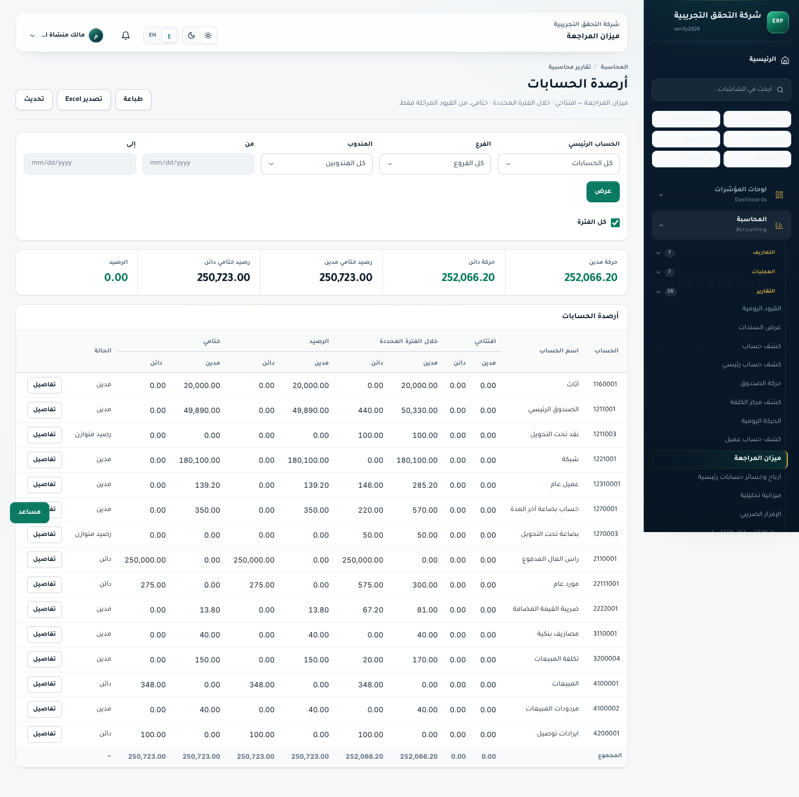

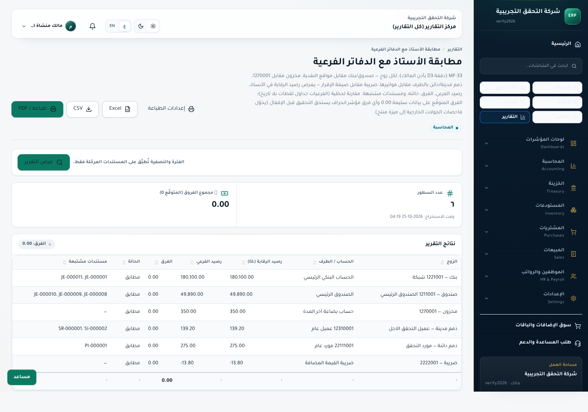

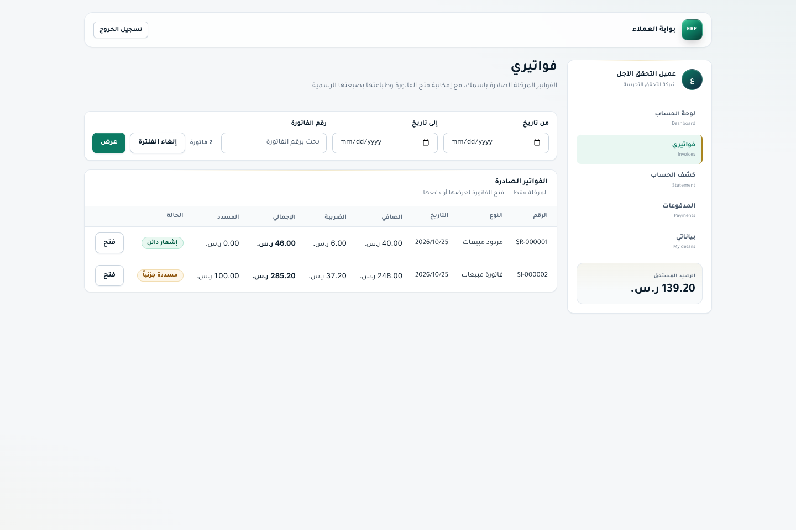

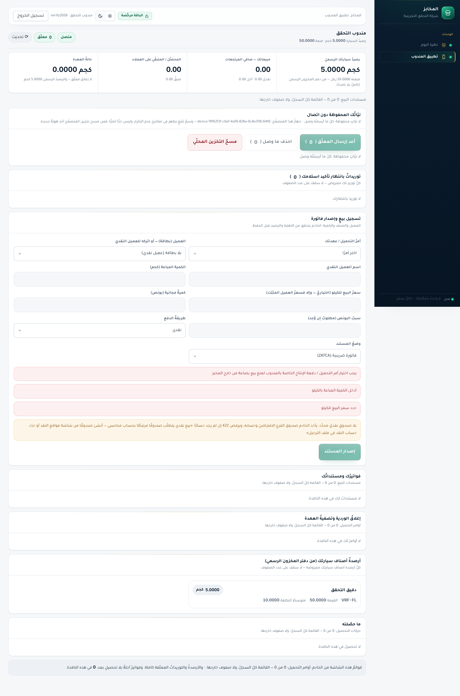

---

## 3. العيوب المكتشفة والمؤكدة بالفحص البصري والمطابقة الحية (`NEW-01` .. `NEW-07`)

هذه العيوب إمّا **اكتُشفت لأول مرة** أثناء هذا الفحص الحيّ بالمتصفح والمطابقة، أو تبيّنت لها أبعاد بصرية/حسابية إضافية لم ترصدها الفاحصات النصية السابقة:

### `NEW-01` — **HIGH (محاسبي / بطاقات مؤشرات المبيعات)** — شاشة `/sales/invoices` تعرض ذمم العملاء غير المسددة **`185.20`** بدل **`139.20`** وتوسم مردود المبيعات المرحّل بـ **`غير مسدّدة`**
- **المسار:** `apps/staff/app/sales/invoices/page.tsx` (`/sales/invoices`).
- **البرهان الحيّ على `verify2026`:**
  - الفاتورة الآجلة `SI-000002` إجماليها `285.20`، سُدِّد منها نقداً `100.00`، ورُحِّل عليها مردود مبيعات `SR-000001` بقيمة `46.00`.
  - الرصيد الفعلي المتبقي على العميل في الأستاذ (`12310001`) وتقرير `ar-aging` وتقرير `MF-33` وبوابة العملاء (`:3004`) هو **`139.20 ر.س.`** (`285.20 - 100.00 - 46.00`).
  - أمّا شاشة `/sales/invoices` فتعرض:
    1. بطاقة `قيمة المبيعات`: **`354.20`** (`115.00 + 285.20 - 46.00` — هنا طرحت المردود بشكل صحيح).
    2. بطاقة `غير مسددة — المتبقي على العملاء (ذمم المبيعات)`: **`185.20`** (`285.20 - 100.00` — **تجاهلت المردود `46.00`!**).
    3. شارة حالة السطر `SR-000001` (`مردود مبيعات`): **`غير مسدّدة`** (وتحتسبها في فلتر `غير مسددة 1`)، على عكس بوابة العملاء (`19-portal-invoices.png`) التي تعرض لها شارة **`إشعار دائن`**!
- **الدليل البصري:**

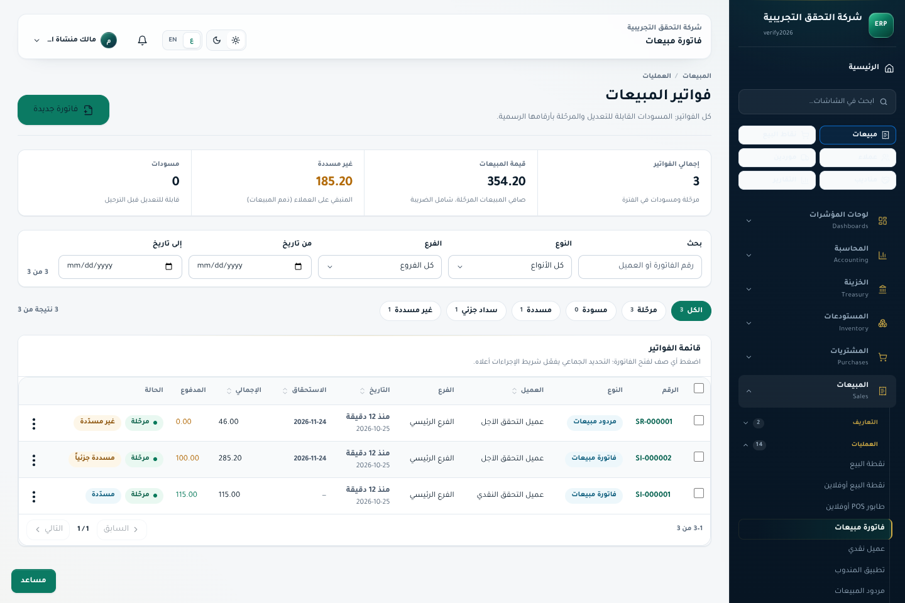

---

### `NEW-02` — **MEDIUM (كشف حساب الطرف — واجهة + API)** — شاشة `/sales/statements` تفتقر لأعمدة المستند/البيان، وتكرّر عمود `المسدّد` على سند السداد، وتثبّت العنوان العلوي على `كشف مورد` حتى للعملاء
- **المسار:** `apps/staff/app/sales/statements/page.tsx` + `apps/api/src/modules/parties/parties.service.ts` (`L354–364`).
- **الأعراض المرصودة بصرياً في `04-sales-statements-customer.png` و`05-sales-statements-supplier-acc222.png`:**
  1. **غياب هوية الحركة:** الجدول يعرض الأعمدة (`التاريخ | مدين | دائن | المسدّد | الرصيد`) فقط دون **رقم المستند (`JE / SI / PI / PV`)** أو **البيان**، فلا يستطيع المحاسب معرفة أي فاتورة أو سند يمثّله السطر!
  2. **تكرار مضلِّل لعمود `المسدّد`:** في كشف المورد (`05-sales-statements-supplier-acc222.png`)، يظهر `المسدّد: 300.00` أمام سطر الفاتورة (`575.00`) **ومرة ثانية `المسدّد: 300.00` أمام سطر سند الصرف نفسه (`300.00`)** لأن `parties.service.ts` يجمع التخصيصات بشرط `a.invoiceId === row.sourceId || a.voucherId === row.sourceId`.
  3. **خطأ لغوي محاسبي في التسمية:** البطاقة اليسرى معنوَنة `الرصيد الدائن (مستحق عليه)` بينما الرصيد الدائن التزام **مستحق له / علينا** لا عليه.
  4. **ثبات عنوان الشريط العلوي على `كشف مورد`:** حتى عند اختيار `النوع = عميل` وعرض `عميل التحقق الآجل`، يبقى العنوان في أعلى الصفحة **`كشف مورد`**!
- **الدليل البصري:**

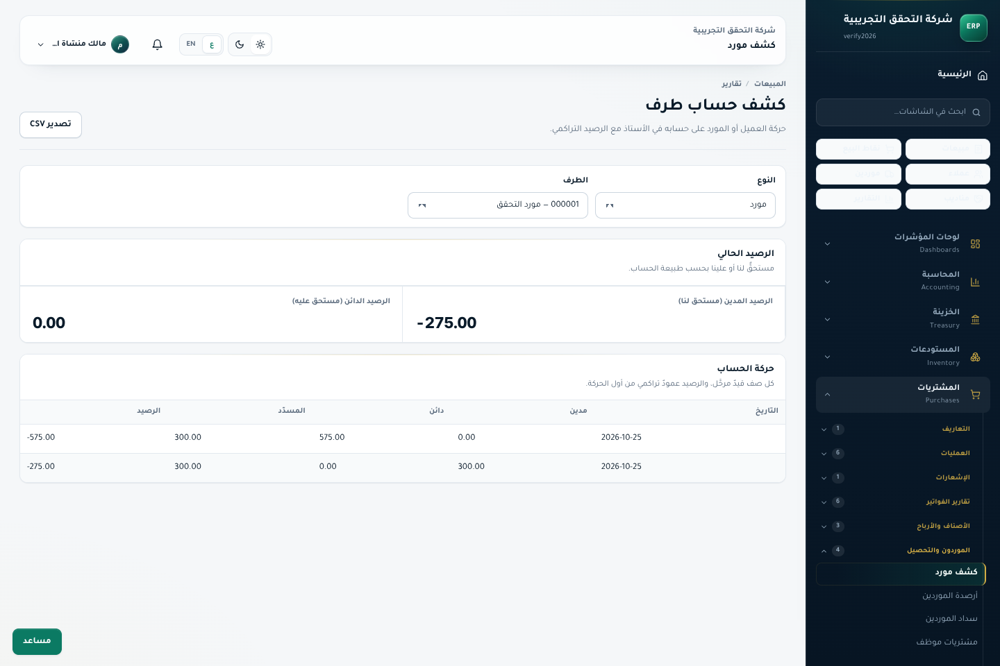

---

### `NEW-03` — **MEDIUM (شاشة مراكز التكلفة + منطق الفلترة بالفرع)** — زر `<Link>` أبيض فارغ ممتد + زر حذف أحمر مسمّى بالخطأ «`🗑 كشف الحساب`» + خلل فلترة `branch_id` في `listCostCenters`
- **المسار:** `apps/staff/app/accounting/cost-centers/page.tsx` (`L356–365`) + `apps/api/src/modules/accounting/accounting.service.ts` (`L2421–2455`).
- **ما كشفه الفحص البصري والكودي الحيّ:**
  1. في السطر `356` من `cost-centers/page.tsx`: `<Link className="btn sm" href={...}></Link>` **بلا أي نص داخله**، ويتمدد عبر الـ flex ليملأ نصف عرض السطر كمستطيل أبيض فارغ ضخم!
  2. في السطر `360–365`: زر الحذف `onClick={() => remove.mutate(node.id)}` الملوّن بالأحمر مع أيقونة `<Trash2 />` وُضع داخله النص **`كشف الحساب`** بدلاً من **`حذف`** — أي أن المحاسب الذي يضغط «كشف الحساب» **يحذف مركز التكلفة** بدلاً من فتح كشفه!
  3. في الخادم (`accounting.service.ts:2430,2439-2454`): عند طلب `GET /cost-centers?with_balances=1&branch_id=<id>`، يفلتر الاستعلام الأول جدول `cost_centers.branch_id = branchId` (فيُخفي جميع مراكز التكلفة العامة التي `branch_id IS NULL` — أرجع `0` صفوف لفرع `BR2` في فحصنا الحيّ!)، بينما الاستعلام الثاني على `journal_entry_lines` **لا يفلتر `journal_entries.branch_id` إطلاقاً** فيجمع حركات كل الفروع!
- **الدليل البصري:**

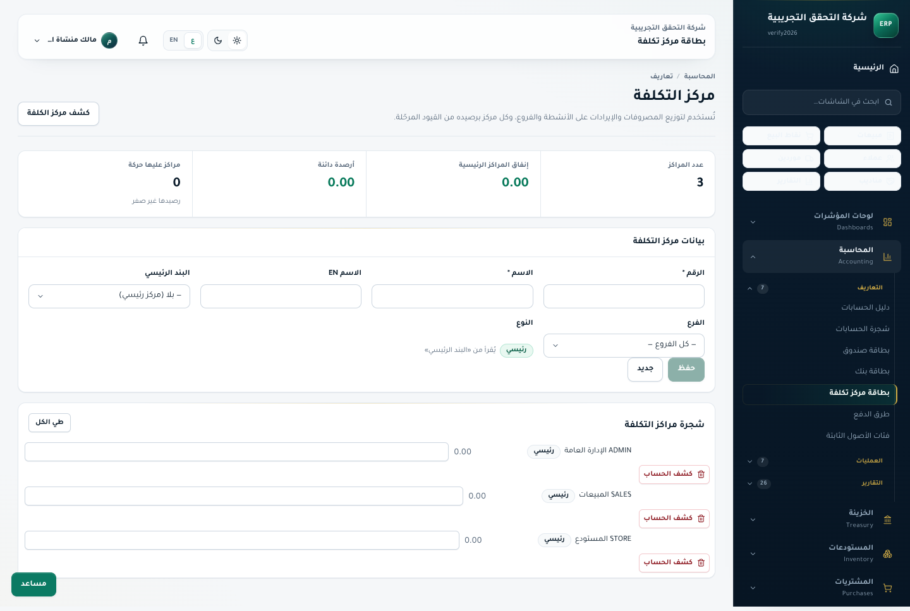

---

### `NEW-04` — **MEDIUM (واجهة عامة / تباين لوني فاشل في الشريط الجانبي)** — 6 أزرار وصول سريع بيضاء بنص أبيض شبه غير مرئي في جميع شاشات `apps/staff`
- **المسار:** مكوّن الشريط الجانبي العام (`AppShell` / `Sidebar`) في `apps/staff`.
- **الوصف المرصود بصرياً في جميع لقطات `apps/staff`:** أسفل مربع البحث `ابحث في الشاشات...` مباشرةً، تظهر 6 أزرار سريعة (`مبيعات`، `نقاط البيع`، `عملاء`، `موردين`، `مناديب`، `التقارير`) بخلفية بيضاء ناصعة (`#fff`) ونص فاتح جداً مخصّص للخلفية الداكنة، فلا يُقرأ الزر إلا عند تفعيله باللون الداكن.

---

### `NEW-05` — **LOW-MEDIUM (عيوب تخطيط وأزرار فارغة وتداخل عناصر في `Staff`)**
1. **`apps/staff/app/accounting/ledger/page.tsx:509` (`12-accounting-ledger.png`):** عمود الإجراء الأيسر في جدول «حركة الحساب» يرسم أزرار `<Link className="btn sm" href="/accounting/journal-entries/...">` **فارغة تماماً من أي نص أو أيقونة** في كل سطر.
2. **تداخل الزر العائم الأخضر `مساعد` (`24-purchase-return-ref-acc021.png` و`12-accounting-ledger.png`):** يغطّي زر `حفظ كمسودة` في محرر فاتورة الشراء، كما يغطّي حقل الباركود المقصوص جزئياً وأقصى يسار الجداول العريضة في تخطيط `RTL`، مع خروج حقل `التسلسلي` عن حدود البطاقة اليسرى.
3. **تكدّس وقصّ حقول مودال التفصيل (`27-tailoring-invoices-ui047.png`):** شبكة الـ 6 أعمدة داخل المودال الضيق تقصّ نصوص القوائم المنسدلة (`اسم العميل` ← `اخا`، `الحالة` ← `مس`) وتقصّ صف مقاسات الجيب السفلي عند حافة التمرير.
4. **مربعات محارف مفقودة (`Tofu ▯`):** تظهر مكان بعض الرموز التعبيرية/العلامات (`💰 مجموع الفروق` في `MF-33`، `الحسابات متوازنة` في قائمة الدخل، و`نوع الجيب` في مودال التفصيل) عند عدم توفر خط Emoji على جهاز العميل، مع ظهور نقاط مفردة `. . .` في سطر الإجمالي السفلي لبعض تقارير الكتالوج.

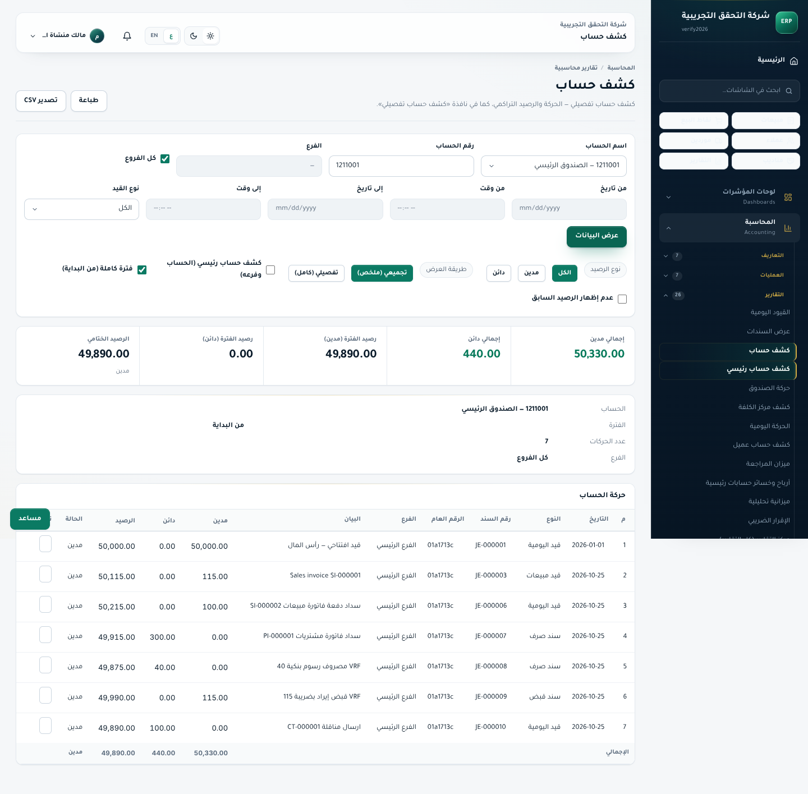

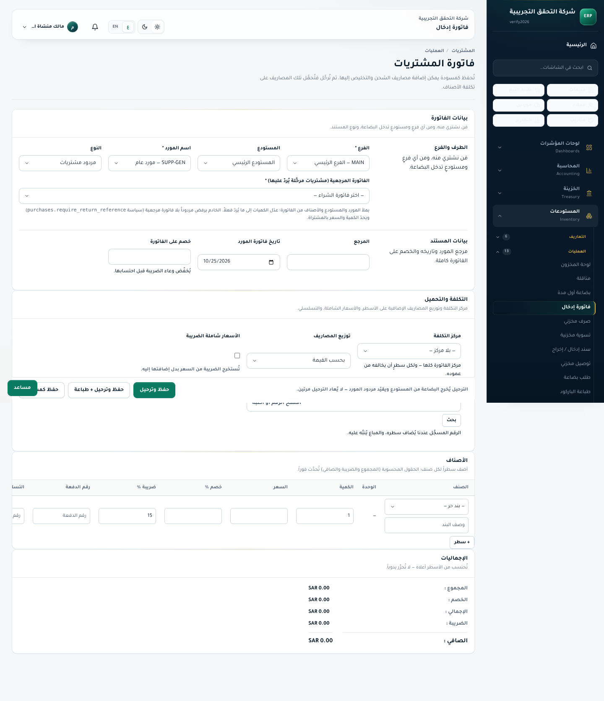

---

### `NEW-06` — **LOW (تقرير `MF-33` — تشخيص المستندات المشتبهة)** — عمود `مستندات مشتبهة` يبقى `—` رغم وجود `فرق: 1.00` فعلي على المخزون `1270001`
- **المسار:** `apps/api/src/modules/reporting/report-catalog.ts` (`subledger-reconciliation`).
- **البرهان الحيّ (`31-demo-recon-acc061-diff-1sar.png`):** عند ترحيل فاتورة شراء بخصم رأس `1.00` (`ACC-061`)، اكتشف التقرير الفارق فوراً (`رصيد الرقابة: 376.00` مقابل `رصيد الفرعي: 375.00` = `الفرق: 1.00`، `الحالة: فرق`)، لكن عمود `مستندات مشتبهة` عرض `—` بدلاً من إدراج فاتورة الشراء ذات خصم الرأس (`PI-000001`)، في حين أدرج `JE-000001` كمستند مشتبه أمام صف البنك المطابق أصلاً (`الفرق: 0.00`)!

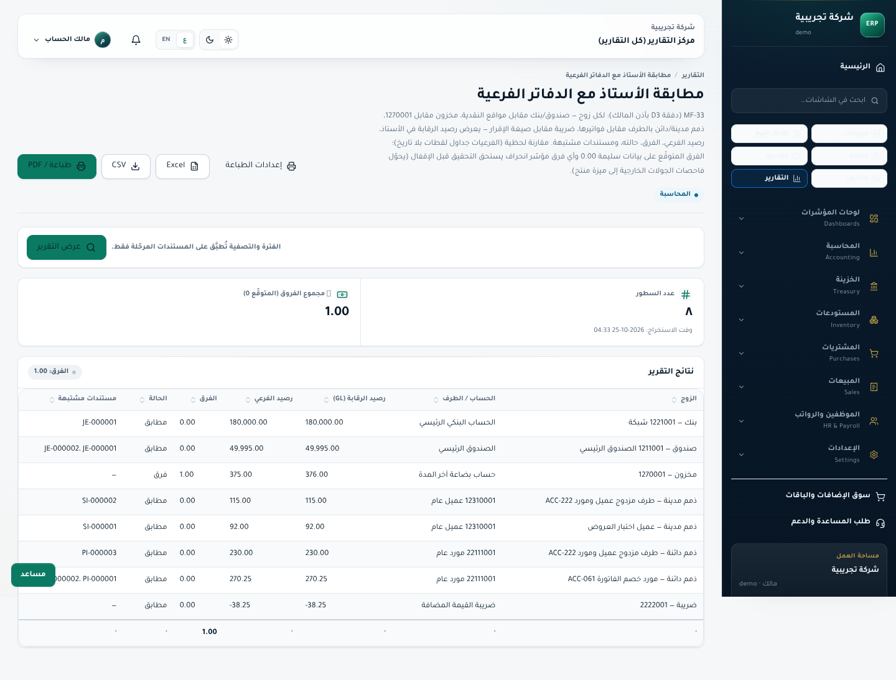

---

### `NEW-07` — **LOW (بوابة العملاء `:3004` + تطبيق المخبز `:3005`)**
1. **فقدان جلسة بوابة العملاء عند التحديث الكامل (`Full Reload`) على HTTP المحلي:** تخزّن `apps/customer-portal` رمز الوصول في ذاكرة المتصفح فقط، وعند فتح أي مسار فرعي مباشرةً (`/portal/invoices`) أو الضغط على `F5` عبر `http://127.0.0.1:3004` تعود الجلسة إلى `/auth/login` ما لم يتم التنقل عبر روابط SPA الداخلية.
2. **نص مبتور في `:3005/reps` (`22-bakery-reps-rbac.png`):** عند عدم ضبط متغير البناء `NEXT_PUBLIC_STAFF_URL`، يظهر النص: `أمّا البطاقة نفسها فتُنشأ وتُعدَّل في apps/staff على .` بنقطة معلّقة بلا رابط.

---

## 4. مصفوفة التحقق الحيّ الشاملة لبطاقات `DEFECTS.md`

يضم سجل `docs/accounting-audit/DEFECTS.md` ما مجموعه **`263` بطاقة فريدة** (`214 ACC` + `49 UI`). في هذا التدقيق أعدنا التحقق الحيّ (API + DB + متصفح فعلي) من جميع البطاقات الحرجة/المفتوحة/المؤجلة، بالإضافة إلى الشاشات التي أُشير إليها في `REMEDIATION_R33.md` بأنها فُحصت كودياً دون متصفح:

### 4.1 بطاقات ثبت حيّاً أنها **مفتوحة أو ذات أثر انحراف قائم** (تستوجب معالجة هندسية)

| المعرّف | الحالة المدوّنة في `DEFECTS.md` | النتيجة الحية في تدقيقنا (`2026-10-25`) | الدليل الرقمي / البصري المباشر |
|---|---|---|---|
| **`ACC-222`** | `OPEN` (`MEDIUM`) | 🔴 **مؤكد مفتوح حيّاً وبصرياً** | على `verify2026`: كشف المورد يعرض `مدين: -275.00` و`دائن: 0.00`. وعلى `demo` لطرف `both` (مبيعات `115` + مشتريات `230` + مصروف موسوم بالطرف `50`): أرجع `receivable: "-115.0000"` و`payable: "0.0000"`! (`05-sales-statements-supplier-acc222.png` + `live-audit-summary.json`) |
| **`ACC-221`** | `OPEN` (`LOW`) | 🔴 **مؤكد مفتوح حيّاً** | `POST /api/v1/accounts` بـ `{code:'999221', type:'income'}` أعاد **`500 INTERNAL`** بدل `422` (`traceId: 01a17152-a7a8-758e-97c6-d7eb01485d72`). |
| **`ACC-061`** | `POLICY-DOCUMENTED` (`HIGH`) | 🟠 **انحراف فعلي دائم بين الأستاذ والمخزون** | فاتورة شراء `4×10` بخصم سطر `10%` وخصم رأس `1.00`: قيّدت `1270001 = 36.00` و`3200003 = 1.00` بينما دخل المخزون الفرعي بـ `35.00`، فأضاء تقرير `MF-33` فوراً بـ **`فرق: 1.00` (`حالة: فرق`)**! (`31-demo-recon-acc061-diff-1sar.png`) |
| **`ACC-138`** | `DEFERRED-TO-MF` (`HIGH`) | 🔴 **مؤكد غير موصول حيّاً** | العرض الترويجي `OFF` (`كمية ≥ 2 ← خصم 10%`) أعاد في `/sales/offers/:id/evaluate` `{eligible: true, discount: "8.0000"}`، لكن فاتورة البيع لقطعتين رُحِّلت بـ **`total: 92.0000` و`invoiceDiscount: 0.0000`** بدل `82.80`! كما أن المسار `/sales/offers` في `apps/staff` غير موجود (`404 الصفحة غير موجودة` في `28-sales-offers-acc138.png`). |
| **`ACC-111`** | `DEFERRED-TO-MF` (`MEDIUM`) | 🔴 **مؤكد غير موصول بالبيع** | لا استهلاك لجدول `price_list_items` في `sales.service.ts` ولا في محرر فاتورة البيع، والمسار `/sales/price-lists` غير موجود كشاشة مستقلة. |
| **`ACC-139` / `MF-01`** | `FIXED-VERIFIED-R33` (`HIGH`) | 🟠 **مُصلَح جزئياً فقط (التنبيه يعمل وأصل الخلل قائم)** | أصلح R33 حقل `balanced` وشاشة ميزان المراجعة فأصبحت تعرض **`الرصيد: 1,500.00 مدين`** باللون البرتقالي (`30-demo-tb-acc139-unilateral-opening.png`)، **لكن** الخادم ما يزال يسمح بإنشاء حساب برصيد افتتاحي أحادي `1,500.00` بلا قيد مقابل، والميزانية العمومية ترقّع الفارق بسطر اصطناعي بلا كود حساب (`أرصدة افتتاحية: 1500.0000`)! |
| **`ACC-209`** | `MITIGATED-R33` (`MEDIUM`) | 🟠 **مؤكد أثناء البناء الحيّ** | أثناء `NODE_ENV=production pnpm --filter @erp/staff build` طبع المترجم صراحةً **`Skipping linting`** بسبب بقاء `eslint.ignoreDuringBuilds: true` في `apps/staff/next.config.mjs`. |
| **`ACC-149` / `MF-47`** | `FIXED-VERIFIED-R33 (جزئي)` | 🟠 **ضريبة `15%` ثابتة برمجياً** | إنشاء فاتورة تفصيل `TI-000001` بسعر `200.00` أنتج `total: 200.0000` و`totalWithTax: 230.0000` (`15%` ثابتة في الكود، وليست مرتبطة بعدُ بـ `tax_groups` للمستأجر). |
| **`ACC-141` / `MF-46`** | `DOCUMENTED-OPEN-POLICY` | 🟡 **سياسة موثّقة (ترحيل فوري للقيود اليدوية)** | `POST /journal-entries` يرحّل القيد اليدوي المتوازن مباشرةً بحالة `posted` دون دورة مسودة منفصلة. |

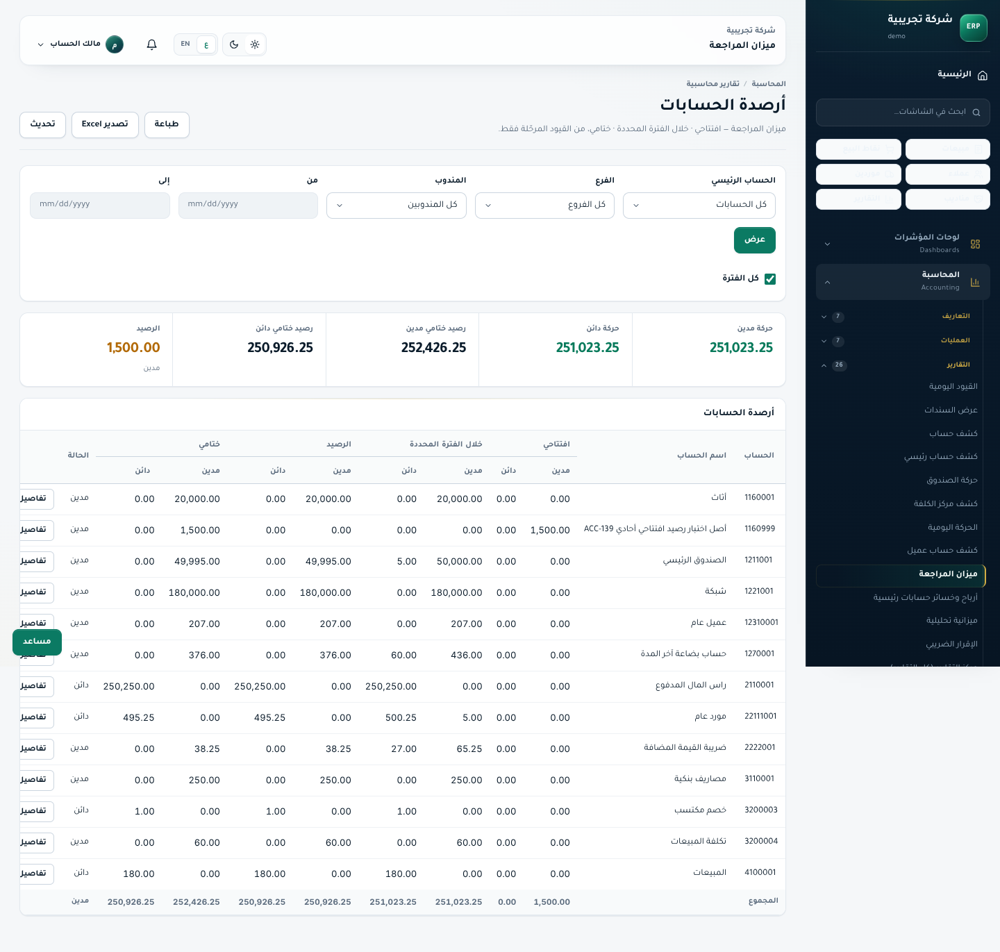

---

### 4.2 بطاقات ثبت حيّاً وبصرياً أنها **مُصلَحة بالكامل** (بما فيها شاشات R33 غير المصوَّرة سابقاً + تصحيح حالة `ACC-171`)

| المعرّف | ما تم التحقق منه حيّاً وبصرياً في هذه الجولة | النتيجة والدليل |
|---|---|---|
| **`ACC-171`** | كانت لا تزال موسومة **`OPEN`** في `DEFECTS.md`! اختبرنا `POST /vouchers` بلا `date/method` وبـ `method:'bank'` حيّاً | ✅ **مُصلَح فعلياً في الكود والخادم الحيّ!** كلا الطلبين أعادا **`422 VOUCHER_INPUT_INVALID`** مع `{ errors: [{ field: "method" }] }` بدل `500 INTERNAL` — يلزم فقط تحديث حالتها في `DEFECTS.md`. |
| **`ACC-140`** | كانت الميزانية تتجاهل `accounts.opening_balance` | ✅ **مُصلَح حيّاً:** حساب `1160999` ظهر في `GET /reports/balance-sheet` برصيد `1500.0000` (مع سطر موازن `أرصدة افتتاحية` تحت حقوق الملكية). |
| **`ACC-143`** | قيد يدوي بمعرّف مركز تكلفة غير موجود | ✅ **مُصلَح حيّاً:** أعاد **`404 COST_CENTER_NOT_FOUND`** ومنع الترحيل. |
| **`ACC-144`** | `GET /cost-centers?with_balances=1` وتجميع الأبناء في الشجرة | ✅ **مُصلَح حيّاً:** قيد بـ `250.00` على المركز الفرعي `CC-AUD-609` أظهر `ownBalance: 250.0000` وجمّعه في المركز الرئيسي `ADMIN` (`rolledUp: 250.0000`) — مع بقاء خلل فلتر الفرع `NEW-03`. |
| **`ACC-192`** | تقرير أعمار الذمم المدينة والدائنة (`ar-aging` / `ap-aging`) | ✅ **مُصلَح حيّاً:** `ar-aging` على `verify2026` أظهر `139.20` (بعد خصم التحصيل `100` والمردود `46`)، و`ap-aging` أظهر `275.00`. |
| **`ACC-021`** | شاشة مردود المشتريات `/purchases/invoices/new` وسياسة `purchases.require_return_reference` | ✅ **مُتحقّق بصرياً بالمتصفح** (`24-purchase-return-ref-acc021.png`): حقل `الفاتورة المرجعية (مشتريات مرحّلة يُردّ عليها) *` ظاهر ومفعّل. |
| **`ACC-211`** | حجب `/reps` في تطبيق المخبز (`:3005`) عن دور المندوب | ✅ **مُتحقّق بصرياً بالمتصفح** (`22-bakery-reps-rbac.png`): القائمة تُخفي الرابط، والمسار المباشر يعرض رسالة رفض الصلاحية الصريحة `van_sales.load.manage`. |
| **`UI-006`** | بطاقة `الكمية المسلّمة` في `/inventory/deliveries` | ✅ **مُتحقّق بصرياً بالمتصفح** (`25-inventory-deliveries-ui006.png`): تعرض `0` للسندات المسلّمة، و`19` للكميات المتبقية (`14` على `SI-000002` بعد المردود + `5` على `SI-000001`). |
| **`UI-020`** | شاشة التسوية البنكية `/treasury/bank-reconciliation` | ✅ **مُتحقّق بصرياً بالمتصفح** (`26-bank-reconciliation-ui020.png`) وكود زر «سند مصروف» للسطور المدينة المعلّقة موجود ومربوط بـ `/treasury/vouchers`. |
| **`UI-047`** | البذر التلقائي لحالات طلبات التفصيل في `/tailoring/invoices` | ✅ **مُتحقّق بصرياً بالمتصفح وحيّاً بـ API** (`27-tailoring-invoices-ui047.png` + `TI-000001` أُنشئت تلقائياً بحالة `مستلم` دون `404`). |

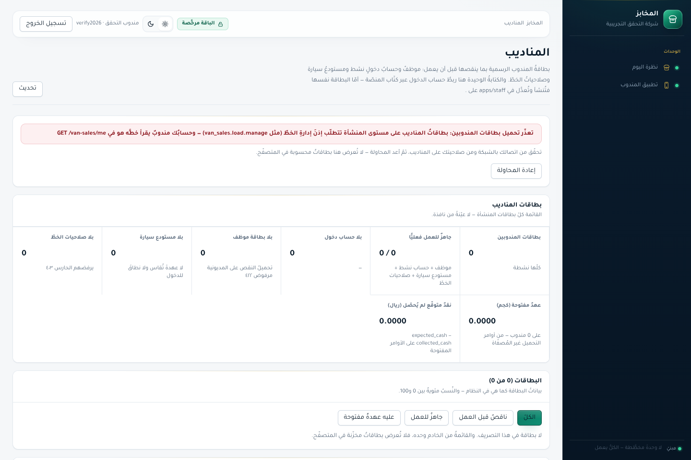

---

### 4.3 تضاربات توثيقية في `DEFECTS.md` (`Doc-Sync`)

أثناء مطابقة حالات البطاقات مع السلوك الحيّ، رُصدت **5 بطاقات** تحمل حالات متعارضة أو غير محدّثة داخل `DEFECTS.md`:
1. **`ACC-171`:** ما تزال موسومة `الحالة: OPEN` بينما الخادم الحيّ يردّ `422 VOUCHER_INPUT_INVALID` بنجاح (مُصلَحة فعلياً).
2. **`ACC-058`، `ACC-132`، `UI-044`:** تحمل في ترويستها القديمة `OPEN` وفي ذيلها `FIXED-VERIFIED-R33` دون توحيد حقل الحالة الأعلى.
3. **`ACC-139`:** وُسمت `FIXED-VERIFIED-R33` على أساس إصلاح حقل `balanced: false`، في حين أن الشق الجوهري (منع الرصيد الافتتاحي الأحادي أو إلزام حساب مقابل / قيد افتتاحي) ما يزال مفتوحاً (`MF-01`).

---

## 5. خارطة طريق الإصلاح المقترحة مرتّبة بالأولوية

### الأولوية العاجلة (`P0` — دقة الأرقام المحاسبية وسلامة البيانات)
1. **إصلاح `NEW-01` في `apps/staff/app/sales/invoices/page.tsx`:**
   - استبعاد مستندات `kind === 'sale_return'` من شارة/عداد `غير مسدّدة` (وعرض شارة `مردود / إشعار دائن` كما في بوابة العملاء)، وطرح المردودات المرحّلة من بطاقة `غير مسددة (المتبقي على العملاء)` لتطابق `139.20` في الأستاذ العام و`ar-aging`.
2. **إصلاح `ACC-222` + `NEW-02` في `apps/api/src/modules/parties/parties.service.ts` و`apps/staff/app/sales/statements/page.tsx`:**
   - تصفية `partyBalance` على حسابات الذمم المدينة (`receivable`) والذمم الدائنة (`payable`) كلٌّ على حدة بدل جمع كل سطور الأستاذ في `receivable` وتثبيت `payable = '0.0000'`.
   - إظهار عمودَي **رقم المستند** و**البيان** في جدول `/sales/statements`، وقصر عمود `المسدّد` على سطور الفواتير دون سندات السداد، وتصحيح التسمية إلى `الرصيد الدائن (مستحق له / علينا)`، وربط عنوان الصفحة بنوع الطرف المختار (`كشف حساب عميل` / `كشف حساب مورد`).
3. **حسم سياسة `ACC-061` + تحسين `NEW-06` في `purchases.service.ts` و`report-catalog.ts`:**
   - إمّا تخفيض تكلفة المخزون بخصم رأس الفاتورة الموزّع تناسبياً ليتطابق `GL 1270001` مع `stock_balances` (`35.00 = 35.00`)، أو توثيق الفارق وإظهار فواتير الشراء ذات `invoice_discount > 0` صراحةً في عمود `مستندات مشتبهة` داخل تقرير `MF-33`.
4. **إغلاق فجوة الرصيد الافتتاحي الأحادي (`ACC-139` / `MF-01`):**
   - إيقاف تعديل `accounts.opening_balance` الأحادي بدون قيد مقابل أو توليد قيد افتتاحي متوازن آلياً على حساب الأرصدة الافتتاحية، للاستغناء عن السطر الاصطناعي غير المرقّم في الميزانية العمومية.

### الأولوية العالية (`P1` — ربط الميزات التجارية والتحقق من المدخلات)
5. **ربط محرك العروض وقوائم الأسعار (`ACC-138` و`ACC-111`):**
   - استدعاء تقييم العروض الفعّالة وقوائم الأسعار الافتراضية/الخاصة بالعميل في `sales.service.ts` ونقطة البيع ومحرر الفاتورة، أو إخفاء واجهات تعريفها لحين اكتمال ربطها حتى لا يُفاجأ التاجر بعدم تطبيق الخصم المعلَن.
6. **إضافة تحقق فوري لنوع الحساب (`ACC-221`) في `accounting.service.ts` (`createAccount`):**
   - التحقق من انتماء `input.type` إلى `['asset', 'liability', 'equity', 'revenue', 'expense']` وإرجاع `422 ACCOUNT_TYPE_INVALID` بدل `500 INTERNAL`.
7. **إصلاح فلتر الفرع في `listCostCenters` (`NEW-03` الشق الخلفي — `accounting.service.ts:2430,2448`):**
   - إبقاء مراكز التكلفة العامة (`branch_id IS NULL`) مع مراكز الفرع المحدد، وتمرير شرط `eq(journalEntries.branchId, query.branchId)` إلى استعلام تجميع `journal_entry_lines`.

### الأولوية المتوسطة (`P2` — إصلاح الأخطاء البصرية وتجربة المستخدم وبوابة الجودة)
8. **إصلاح شاشة مراكز التكلفة (`NEW-03` الشق البصري — `apps/staff/app/accounting/cost-centers/page.tsx:356,364`):**
   - وضع نص `كشف المركز` داخل `<Link>` الفارغ (`L356`) مع إلغاء تمدده العرضي، وتغيير نص زر الحذف الأحمر (`L364`) من `كشف الحساب` إلى `حذف` مع تأكيد قبل الحذف!
9. **إصلاح التباين اللوني لأزرار الشريط الجانبي الستة (`NEW-04`)** في `apps/staff` وإضافة نص `فتح القيد` داخل `<Link>` الفارغ في `apps/staff/app/accounting/ledger/page.tsx:509` (`NEW-05`).
10. **إعادة تفعيل فحص `ESLint` أثناء البناء (`ACC-209`)** بإزالة `ignoreDuringBuilds: true` من `apps/staff/next.config.mjs` ومعالجة التحذيرات المتبقية، واستبدال رموز الإيموجي بأيقونات `lucide-react` لتفادي مربعات `▯`.
