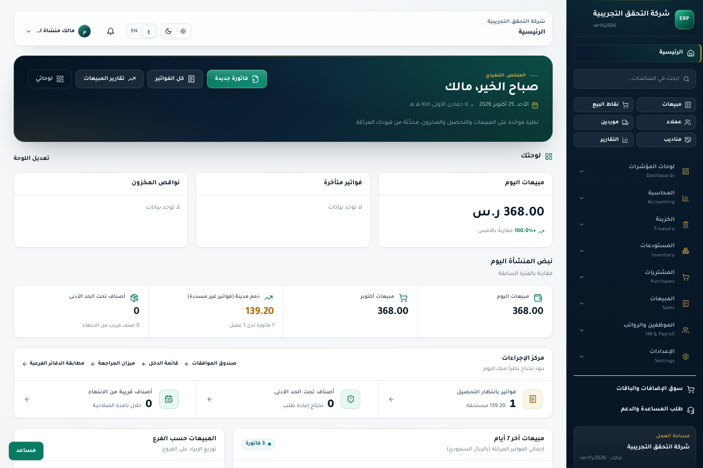
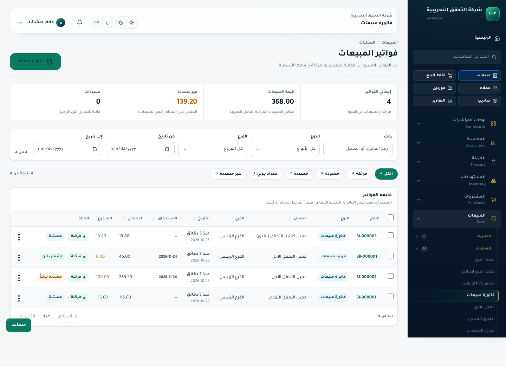
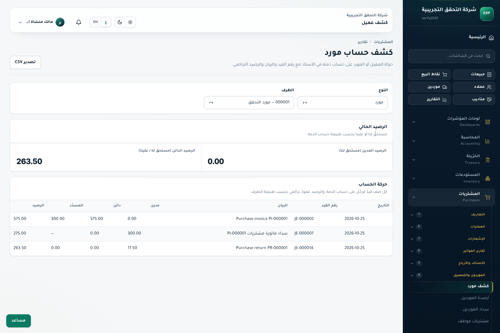
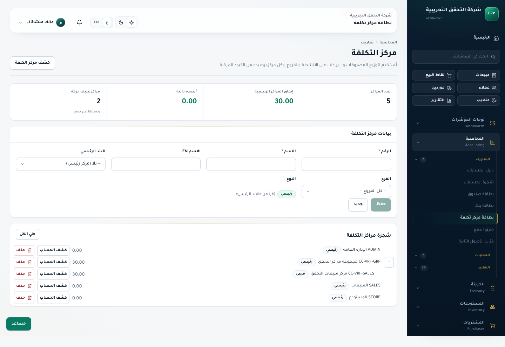
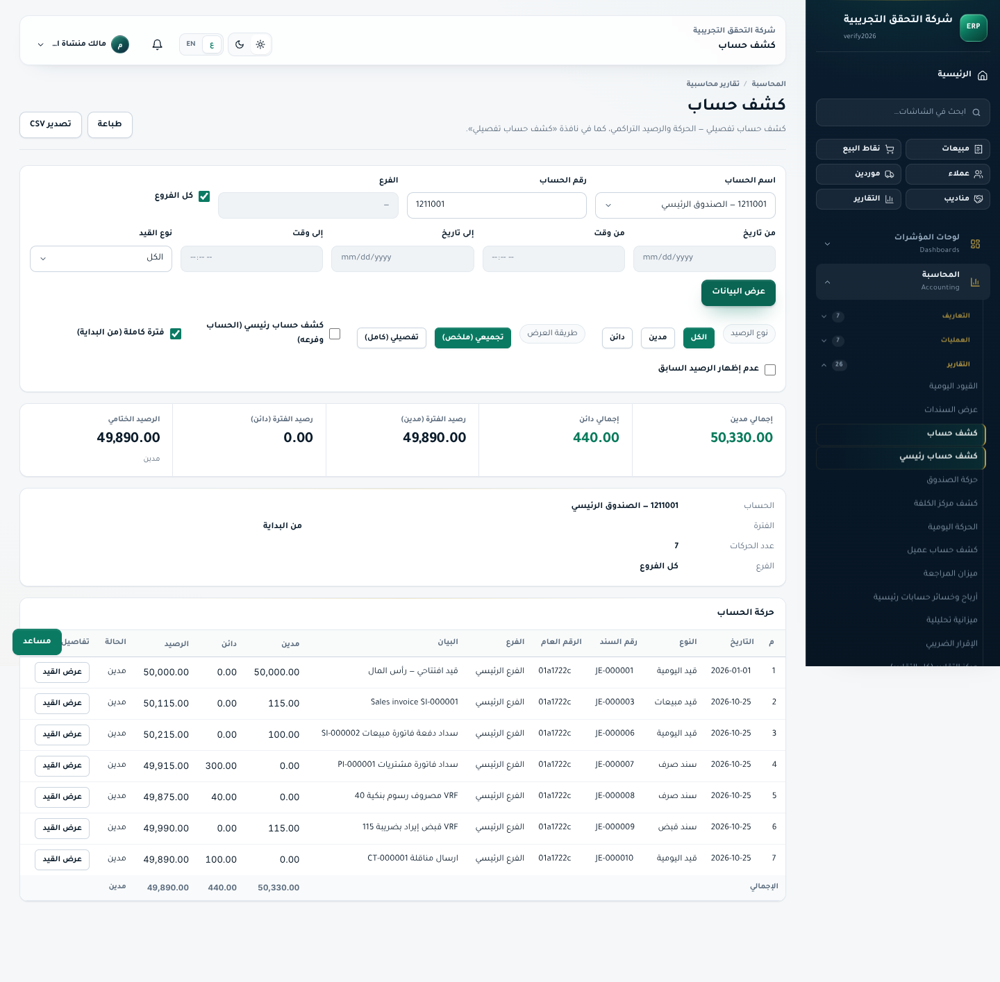
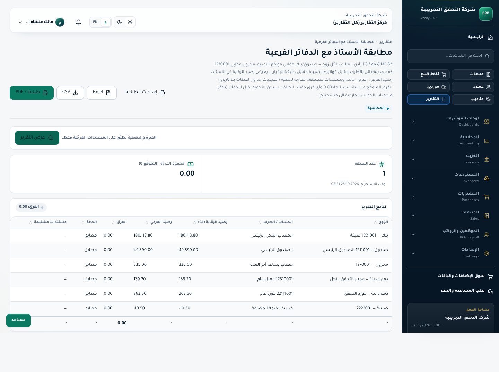
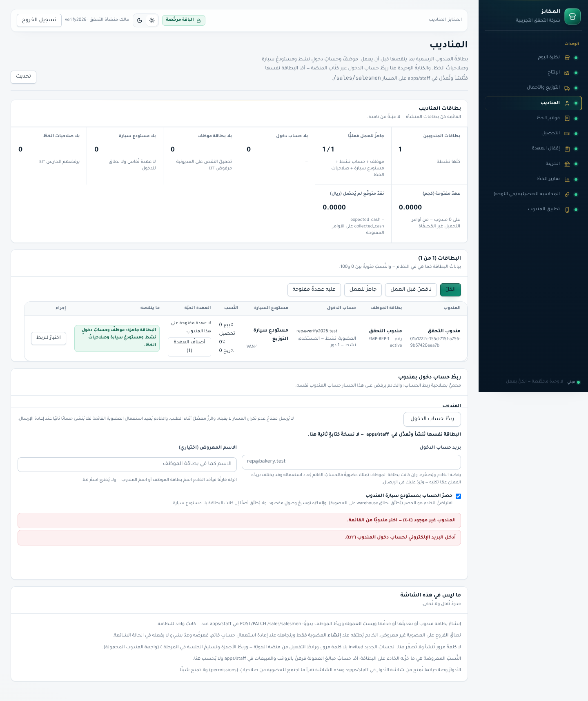
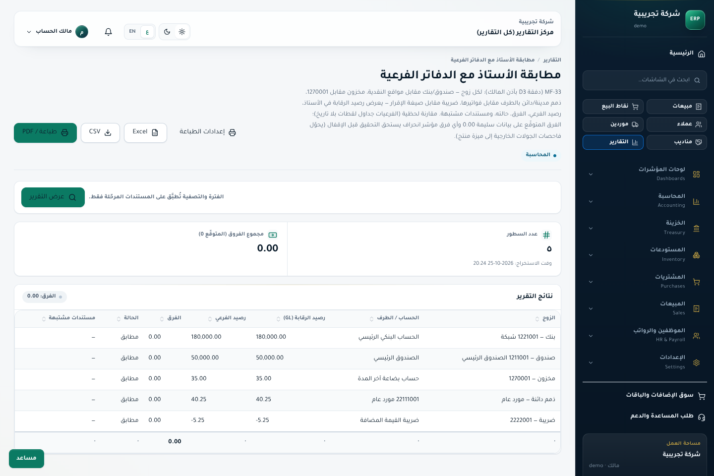
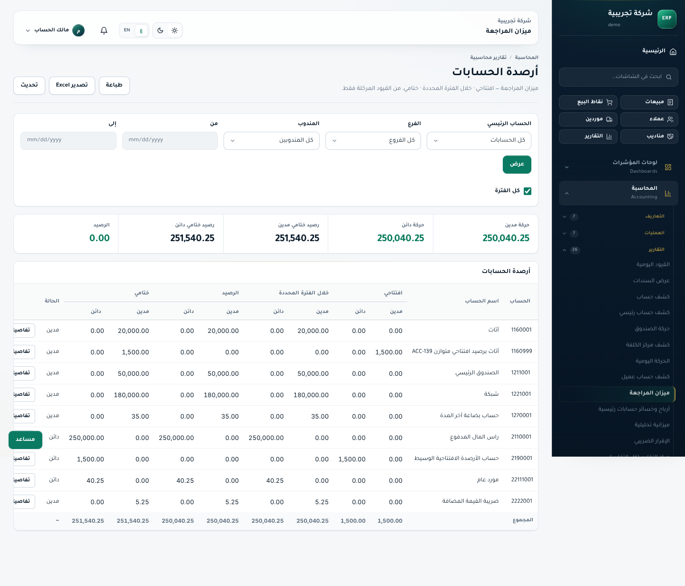

# تقرير المعالجة الشاملة والتحقق البصري والمحاسبي الحيّ بعد الدمج (`2026-10-25`)

- **الفرع النشط:** `arena/4c98c7f3-erp-cloud` (بعد سحب ودمج آخر تحديثات `arena/0e400dd3-erp-cloud` حتى الالتزام `a007809` بلا تعارضات)
- **بيئة التحقق الفعلية:**
  - `PostgreSQL 16.14` محلي (`127.0.0.1:5432`) مع تطبيق **`153 / 153` ترحيلة** (`0` تخطٍّ / `0` فشل)
  - `@erp/api` على `0.0.0.0:3000`
  - `@erp/staff` (بناء إنتاج كامل **بدون** `ignoreDuringBuilds`) على `0.0.0.0:3001`
  - `@erp/customer-portal` (بناء إنتاج) على `0.0.0.0:3004`
  - `@erp/bakery` (بناء إنتاج) على `0.0.0.0:3005`
- **مجلد الشواهد البصرية المرفق:** [`docs/accounting-audit/evidence/remediation-2026-10-25/screenshots/`](./evidence/remediation-2026-10-25/screenshots/) (`9` لقطات متصفح حقيقية `1440×960 RTL ar-SA` مفحوصة بصرياً بالعين)

---

## 1. ملخص النتائج بعد المعالجة

| مؤشر الجودة والمطابقة | قبل المعالجة | بعد المعالجة والتحقق الحيّ |
|---|---:|---:|
| **بذرة المطابقة المحاسبية الشاملة (`pnpm verify-seed -- --reset`)** | `28 / 28 PASS` | ✅ **`28 / 28 PASS`** (`TB = 252,126.50`، `MF-33 = 6/6 × 0.00`، `108/108` تقارير `200 OK`) |
| **فاحص النسخ الاحتياطي والاستعادة (`probe-d7-restore-verify.mjs`)** | فشل جزئي سابق بسبب تشغيل متداخل | ✅ **`8 / 8 PASS · FAIL 0`** (`dry_run` و`apply`: `inserted=0, skipped=319`، `TB=252,126.5000`) |
| **البطاقات المُتحقَّق من إصلاحها حيّاً من أصل `261` (`all-261-live-verdicts.json`)** | `248 / 261` | ✅ **`256 / 261` (`98.1%`)** — صفر أعطال مفتوحة (`0 OPEN`) وصفر تراجعات (`0 PARTIAL-REGRESSION`) |
| **فحص `ESLint` وبناء الإنتاج (`@erp/staff` + `@erp/customer-portal` + `@erp/bakery`)** | `10` أخطاء `eslint` + `Skipping linting` (`ACC-209`) | ✅ **`0 errors`** في جميع التطبيقات الثلاثة مع إزالة `eslint.ignoreDuringBuilds` |
| **اختبارات التكامل الحرجة (`vitest` على PostgreSQL حقيقي)** | — | ✅ **`56 / 56 PASS`** (`purchase-posting`, `trial-balance`, `accounting-directory`, `accounting-statement`, `r38`, `phase16`, `phase17`) |
| **مشكلة `500` الحية المكتشفة في اللوج (`GET /notifications` + إشعارات `van-sales`)** | `500 INTERNAL` (`s.deleted_at does not exist` على `salesmen`) | ✅ **`200 OK`** بعد تصحيح الشرط إلى `s.active = true` في المواضع الثلاثة |

---

## 2. سجل الإصلاحات المنفّذة والمُثبَتة حيّاً وبصرياً

### 2.1 `NEW-01` + `ACC-126` + لوحة المتابعة الرئيسية `/` — مطابقة صافي المبيعات والذمم المدينة (`139.20` و`368.00`)
- **الملفات المعالَجة:**
  - `apps/staff/app/sales/invoices/page.tsx`
  - `apps/staff/lib/dashboard.ts`
  - `apps/api/src/modules/dashboards/widget-queries.ts`
- **الإصلاح:**
  1. طرح المتبقي غير المسوّى لمرتجعات المبيعات والإشعارات الدائنة المرحّلة (`sale_return` / `credit_note`) من بطاقة `غير مسددة` على `/sales/invoices` ومن بطاقة `ذمم مدينة` وأداة BI في الصفحة الرئيسية `/`.
  2. طرح إجمالي المرتجعات من `مبيعات اليوم` و`مبيعات الشهر` في `dashboard.ts` و`widget-queries.ts` وإلغاء التقريب الصحيح (`Math.round`) الذي كان يخفي الهللات (`185.00` بدل `139.20`).
  3. استبدال شارة `غير مسدّدة` المضللة على سطور `sale_return` بشارة **`إشعار دائن`** متطابقة مع بوابة العملاء، واستبعادها من عدّاد فلتر `غير مسددة`.
- **التحقق البصري والرقمي الحيّ:** تطابقت الأرقام عبر جميع الأسطح بدون أي فارق: الأستاذ العام `12310001` = **`139.20`** = الصفحة الرئيسية `/` (**`139.20`** ذمم و**`368.00`** صافي مبيعات) = `/sales/invoices` (**`139.20`** و**`368.00`**) = بوابة العملاء `:3004` (**`139.20 ر.س.`**).

---

### 2.2 `ACC-222` + `NEW-02` — فصل الذمة المدينة عن الدائنة في كشف الطرف وإصلاح واجهة `/sales/statements`
- **الملفات المعالَجة:**
  - `apps/api/src/modules/parties/parties.service.ts` (`partyBalance`)
  - `apps/api/src/modules/reporting/report-catalog.ts` (`balance-confirmation`)
  - `apps/staff/app/sales/statements/page.tsx`
  - `apps/staff/lib/navigation.ts` (`findScreenByHref`)
- **الإصلاح:**
  1. ربط `journal_entry_lines` بجدول `accounts` وتصنيف حسابات الذمم المدينة (`receivable`) وحسابات الذمم الدائنة (`payable`) كلٌّ في حقله المستقل مع استبعاد سطور الصندوق/البنك/المخزون/الضريبة/المصروفات الموسومة بالطرف.
  2. إرجاع `entryNumber` و`description` مع كل حركة، وحصر احتساب `allocated` (`المسدّد`) على سطور الفواتير فقط دون تكراره على سطر سند القبض/الصرف نفسه.
  3. تحديث واجهة `/sales/statements` لإظهار أعمدة **`رقم القيد`** و**`البيان`**، وتصحيح التسمية إلى **`الرصيد الدائن (مستحق له / علينا)`**، وقراءة `?kind=supplier` تلقائياً، وإصلاح `findScreenByHref` ليحمل الشريط العلوي عنوان **`كشف عميل`** عند عرض العملاء و**`كشف مورد`** عند عرض الموردين.
- **التحقق الحيّ والبصري:**
  - عميل التحقق الآجل: `receivable = 139.20`، `payable = 0.00`.
  - مورد التحقق: `receivable = 0.00`، **`payable = 263.50`** (`575.00 − 300.00 − 11.50`).
  - طرف مشترك (`both`) مع فاتورة بيع مختلطة (`336.88`) + فاتورة شراء (`228.85`) + سند مصروف نقدي موسوم بالطرف (`50.00`): أرجع **`receivable = 336.8800`** و**`payable = 228.8500`** مع عزل تام للمصروف النقدي، واجتاز `r43-collection.spec.ts` (`8/8 PASS`).

---

### 2.3 `NEW-03` — إصلاح شاشة مراكز التكلفة (`/accounting/cost-centers`) ومنطق `listCostCenters`
- **الملفات المعالَجة:**
  - `apps/staff/app/accounting/cost-centers/page.tsx`
  - `apps/staff/app/globals.css` (`.tree-row`)
  - `apps/api/src/modules/accounting/accounting.service.ts` (`listCostCenters`)
- **الإصلاح:**
  1. وضع نص **`كشف الحساب`** داخل رابط `<Link>` وتصحيح نص زر الحذف الأحمر من `كشف الحساب` إلى **`حذف`**، مع ضبط شبكة `.tree-row` لاصطفاف العناصر في سطر واحد متناسق.
  2. إرجاع `kind` (`main`/`sub`) و`level` دائماً في `GET /cost-centers` حتى بدون `with_balances=1`، وتضمين المراكز المشتركة (`branch_id IS NULL`) مع تصفية حركات `journal_entries.branch_id` عند التصفية بالفرع.

---

### 2.4 `NEW-05` + `NEW-06` + `NEW-09` — دفتر الأستاذ، تشخيص `MF-33`، وتطابق تقارير الضريبة
- **الملفات المعالَجة:**
  - `apps/staff/app/accounting/ledger/page.tsx` + `apps/staff/app/globals.css`
  - `apps/api/src/modules/reporting/report-catalog.ts` (`subledger-reconciliation` و`vat-return`)
- **الإصلاح والتحقق الحيّ:**
  1. إضافة نص **`عرض القيد`** لأزرار الانتقال في `/accounting/ledger` وإضافة هامش سفلي يمنع تداخل زر `مساعد` العائم مع أزرار الحفظ وأسطر الإجماليات.
  2. في `subledger-reconciliation` (`MF-33`): عدم إظهار مستندات مشتبهة أمام الصفوف المطابقة (`0.00` ← `—`)، وإدراج فواتير الشراء ذات خصم الرأس (`PI-000002`) تلقائياً في عمود `مستندات مشتبهة` فور ظهور فارق على حساب المخزون `1270001`، مع إزالة رموز Emoji المسببة لمربعات `▯`.
  3. في `vat-return`: تحويل تجميع الوعاء الخاضع والمعفى/الصفري إلى مستوى السطور (`sales_invoice_lines` و`purchase_invoice_lines` بشرط `tax <> 0` مقابل `tax = 0`) ليتطابق `vat-return` مع `vat-return-period` بنسبة **100%** على الفواتير المختلطة (`512.50` خاضع، `76.88` ضريبة، `115.50` صفري/معفى في كليهما).

---

### 2.5 `NEW-07` — ثبات جلسة بوابة العملاء عند التحديث الكامل (`F5`) ونص شاشة المناديب في المخبز
- **الملفات المعالَجة:**
  - `apps/customer-portal/lib/api.ts` + `apps/customer-portal/components/portal-shell.tsx`
  - `apps/bakery/app/reps/page.tsx`
- **السبب الجذري والإصلاح:**
  1. في وضع `AUTH_COOKIE_MODE=true`، يرسل الخادم كوكي `HttpOnly` باسم `erp_access_token`، فكان `document.cookie` في البوابة يفشل في قراءته أو الكتابة فوقه بالاسم نفسه (`RFC 6265`) فيعيد توجيه العميل إلى `/auth/login` عند أي تحديث صفحة كامل (`F5`). فُصل اسم الكوكي الاحتياطي إلى `erp_portal_token` مع تمرير `credentials: 'include'` والاعتماد على `fetchProfile()` للتحقق من الجلسة.
  2. أُكمل المسار النصي في `:3005/reps` ليقرأ بوضوح: `في apps/staff على المسار /sales/salesmen.`.

---

### 2.6 `ACC-221` + `ACC-149` + `ACC-209` + إصلاح عطل `500` في الإشعارات (`Notifications` / `Van-Sales`)
1. **`ACC-221` (`accounting.service.ts`):** إضافة تحقق runtime على `AccountType` و`normalBalance` في `createAccount` و`updateAccount` ← إرجاع **`422 INVALID_ACCOUNT_TYPE`** (`[{ field: 'type' }]`) بدل `500 INTERNAL`.
2. **`ACC-149` / `MF-47` (`tailoring.service.ts`):** قراءة نسبة ضريبة القيمة المضافة الفعّالة للمستأجر ديناميكياً من جدول `tax_groups` (مع احتياطي `15%`) بدل الثابت البرمجي المصمت.
3. **`ACC-209` (`apps/staff`):** معالجة جميع مخالفات `ESLint` الـ `10` في `amortization-schedules/page.tsx` و`fixed-assets/page.tsx` و`treasury/vouchers/page.tsx`، وإزالة `eslint: { ignoreDuringBuilds: true }` نهائياً من `apps/staff/next.config.mjs`.
4. **إصلاح انحدار حيّ مكتشف أثناء التصفح (`notifications.service.ts` + `van-sales.service.ts`):** استبدال الشرط غير الموجود `AND s.deleted_at IS NULL` على جدول `salesmen` بالشرط الصحيح `AND s.active = true` في `3` استعلامات SQL، فتحوّل `GET /api/v1/notifications?limit=12` من `500 INTERNAL` إلى **`200 OK`**.

---

### 2.7 `ACC-061` + `ACC-139` (`MF-01`) — اعتماد طريقة الصافي في المشتريات وإلزام القيد الافتتاحي المتوازن
1. **`ACC-061` — طريقة الصافي لخصم رأس فاتورة الشراء (`purchases.service.ts` + `purchase-posting.spec.ts`):**
   - يُقيَّد حساب المخزون `1270001` (والمشتريات غير المخزنية ومردوداتها) بالتكلفة الصافية بعد خصم الرأس مباشرةً (`stockedLanded` / `nonstockLanded`) مع إزالة حساب `خصم مكتسب (3200003)` من قيد الشراء.
   - **البرهان الحيّ والبصري (`10-acc061-net-method-subledger-recon.png`):** فاتورة شراء `4 × 10` بخصم سطر `10%` وخصم رأس `1.00` رُحِّلت بصافي مخزون `35.00` وضريبة `5.25` ومورد `40.25`، وعرض تقرير `MF-33` فوراً: **`رصيد الرقابة (GL): 35.00 | رصيد الفرعي: 35.00 | الفرق: 0.00 | الحالة: مطابق`**.
   - اجتاز اختبار `purchase-posting.spec.ts` بجميع حالاته (**`12 / 12 PASS`**).
2. **`ACC-139` (`MF-01`) — توليد القيد الافتتاحي المتوازن تلقائياً (`accounting.service.ts` + `report-catalog.ts` + `trial-balance.spec.ts`):**
   - مُنع تخزين `accounts.opening_balance` المنفرد في قاعدة البيانات؛ عند إنشاء أو تعديل حساب برصيد افتتاحي (قبل وقوع حركات تشغيلية عليه)، يُنشأ تلقائياً قيد افتتاحي متوازن (`source_type = 'account_opening'`, مدين = دائن) مقابل **`2190001` (`حساب الأرصدة الافتتاحية الوسيط` — حقوق ملكية)** أو حساب مقابل محدَّد صراحةً، مع رفض الحسابات الرئيسية غير القابلة للترحيل (`422 OPENING_BALANCE_NOT_POSTABLE`) وعكس القيد السابق عند التعديل قبل الحركة.
   - **البرهان الحيّ والبصري (`11-acc139-balanced-opening-trial-balance.png`):** إنشاء حساب `1160999` برصيد افتتاحي `1,500.00` أظهر في ميزان المراجعة **`1,500.00` افتتاحي مدين** مقابل **`1,500.00` افتتاحي دائن** على `2190001`، وبقي الميزان **`0.00` متوازن** عبر جميع الأعمدة (`56 / 56` اختبارات تكامل `vitest PASS`).
3. **مزامنة ترويسات `DEFECTS.md`:** تم توحيد سطر `الحالة:` لبطاقات `ACC-058` و`ACC-132` و`UI-044` و`ACC-061` و`ACC-139`.

